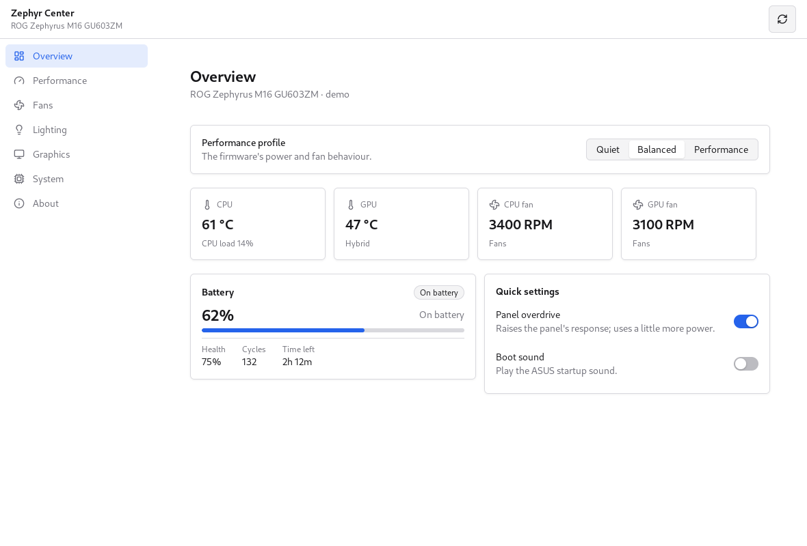
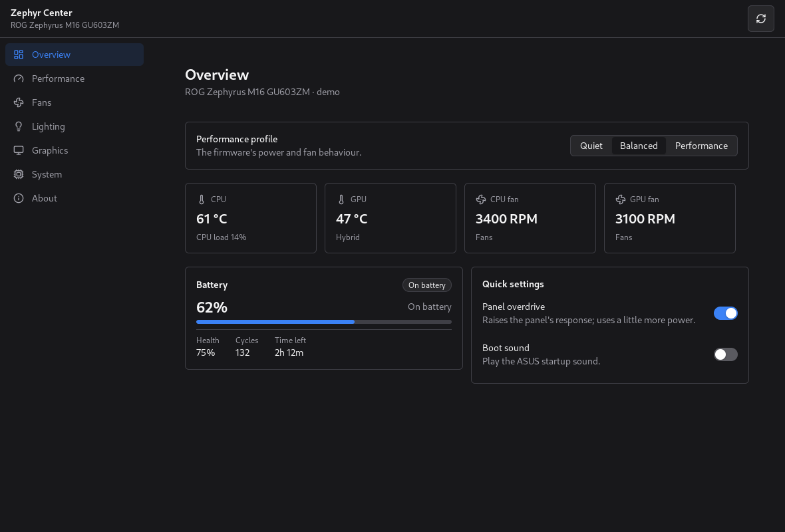

# Zephyr Center

<p align="center">English | <a href="README.zh-Hans.md">简体中文</a></p>

[](https://awesomemygo.dev/apps/zephyr-center)

A lightweight, cross-platform ROG Control Center built with
[MyGo](https://github.com/egoist/mygo) and
[CrychicUI](https://github.com/ELY-Open-Source/CrychicUI): one view with the
same controls and client-side window decorations on Linux and Windows, talking to
[asusd](https://gitlab.com/asus-linux/asusctl) on Linux and
[G-Helper](https://github.com/seerge/g-helper)'s ACPI layer on Windows.

This is the MVP: performance profiles, battery care, fan curves, keyboard
lighting, graphics modes and the machine's details, with English and
Simplified Chinese.



The same view in the dark theme:



## What works

- **Overview** — the profile, battery charge/health/draw and charge limit,
  CPU and GPU temperatures and fan speeds, and the firmware switches
  (panel overdrive, boot sound).
- **Performance** — the platform profile, the PPD presets each profile is
  bound to, and the power limits asusd exposes (PL1, PL2, NVIDIA dynamic
  boost and temperature target). On Linux the CPU boost switch is read
  directly from `cpufreq`/`intel_pstate`, so it also works without asusd.
  Each performance mode remembers its own PL, NVIDIA boost, temperature and
  related firmware values and reapplies them when you switch.
- **Fans** — every profile's CPU and GPU fan curves, edited by dragging the
  eight points or with the arrow keys, with enable/disable and restore to
  the firmware's defaults.
- **Lighting** — brightness, effect, zone, speed, direction, two colours and
  the power states, on both Aura devices asusd finds and ASUS HID keyboards
  under Windows. Every effect the firmware advertises is listed, and each
  performance mode keeps its own lighting scene and brightness.
- **Graphics** — integrated, hybrid and ultimate; only a switch through
  ultimate needs a restart, on both platforms. Leaving Ultimate for
  Integrated is a two-boot path: the MUX moves first, then the discrete GPU
  is switched off once the panel is back on the iGPU.
- **System** — model, board, BIOS, CPU, both GPUs, kernel and OS, plus the
  firmware attributes asusd reads. Windows fills the same fields from WMI,
  including the battery's power draw, health, cycles and time left. On Linux
  it also lists external ASUS/Logitech HID peripherals and the battery their
  receiver exposes; per-model DPI, button and RGB programming is not included.
- **About** — versions, the language picker, and the licences.
- **Tray** — closing the window keeps the app running in the notification
  area. Clicking the icon opens a quick panel with temperatures, fan
  speeds and the graphics mode, switches for the performance and graphics
  modes, and **Quit** in the bottom-right corner. **Open app** brings the
  full window back.

The window redraws from a snapshot every two seconds, so the readings stay
live without blocking the UI thread. When asusd is running it remains the
single writer. If it is missing or does not export the newer
`AsusArmoury` attributes, the backend falls back to the kernel's
`asus-armoury`/`asus-nb-wmi` sysfs interfaces, with the same paths
G-Helper Linux uses.

On Linux the performance page binds each firmware mode to a
power-profiles-daemon preset. On Windows the same card binds it to the
Windows power-mode slider (`Best power efficiency`, `Balanced`,
`Best performance` or the high-performance plan). Both bindings are stored
in `%APPDATA%/zephyr-center` or `$XDG_CONFIG_HOME/zephyr-center` next to the
per-mode lighting and firmware values.

## Run

The repository is `Ne0W0r1d/zephyr-center`; clone it as `zephyr-center`:

```sh
git clone https://github.com/Ne0W0r1d/zephyr-center
cd zephyr-center
```

Linux prefers `asusd` running:

```sh
go run ./cmd/zephyr-center
```

Without asusd, the core switches (platform profile, battery charge limit,
GPU/MUX, panel overdrive, boot sound and CPU boost) still read and write
the kernel's ASUS sysfs attributes. Fan curves and Aura lighting need
asusd, because they use its D-Bus API rather than sysfs.

To try the interface without ASUS hardware, run the demo backend:

```sh
go run ./cmd/zephyr-center -demo
```

The demo is also how the screenshots are made:

```sh
ZEPHYR_SCREENSHOTS=docs/screenshots go test ./internal/app -run TestScreenshots
```

That writes every page, in light and dark. A few are checked in under
`docs/screenshots`.

## Tray

On Linux the tray icon is a StatusNotifierItem registered directly on the
session bus, so it does not need `libayatana-appindicator`. KDE Plasma,
Xfce, Cinnamon and most other desktops show it directly. GNOME needs an
extension that shows status icons, such as **AppIndicator and
KStatusNotifierItem Support**.

If no StatusNotifierWatcher is available, the app logs that the tray could
not be created and keeps the window's close button working normally
instead of hiding the app with no way back. Windows and macOS use MyGo's
native notification area.

## Windows

The Windows build launches `zephyr-center-helper.exe`, a small console program
that links G-Helper's `AsusACPI` ACPI layer and answers JSON over
stdin/stdout. Build both:

```sh
./scripts/build-windows.sh
```

The script publishes `windows/bridge` with `dotnet` and cross-compiles the Go
app, putting both files in `dist/windows/`. Run `zephyr-center.exe` from that
directory. It needs the ASUS ATKACPI driver, as G-Helper does.

Both programs are built as GUI programs (`-H windowsgui` and `WinExe`), and
the helper is started with `CREATE_NO_WINDOW`, so no console appears beside
the window. The app's log goes to `%APPDATA%/zephyr-center/zephyr-center.log`
instead of stderr, which a GUI program has nowhere to write.

The bridge covers profiles, charge limit, per-profile fan curves with the
"use a custom curve" toggle and restore, power limits, graphics modes
including the MUX, keyboard lighting over ASUS HID or ACPI, and the system
and battery details. On Windows the helper remembers per-profile curves and
reapplies the enabled one when the profile changes. PPD preset binding is
Linux-only, since power-profiles-daemon has no Windows counterpart.

Windows names the firmware's turbo profile **Enhanced**, so it does not read
as the Windows power-mode slider on the same page. The firmware cannot be
asked which profile or charge limit is in use — its mode endpoint answers
with the mask of profiles the machine offers — so the helper keeps both in
`%APPDATA%/zephyr-center/bridge.json` and reapplies the profile at startup.

Graphics modes follow the MUX: while it drives the panel from the discrete
GPU (Ultimate), the driver refuses writes to the eco endpoint, so leaving
Ultimate only moves the MUX and takes effect on the next boot. The queued
mode is kept in the same file, together with the Windows boot session that
queued it. At startup the helper reads the firmware back and reconciles the
plan, like G-Helper's `InitGPUMode`: a mode that did not survive the reboot
is dropped instead of being remembered forever, and the deferred eco write
for Integrated is completed after the MUX has moved.

A MUX change is applied by the firmware at POST, not by the driver. For
that reason G-Helper performs a real restart (`shutdown /r`) after writing
it. A Windows "shut down" followed by power-on can use Fast Startup, which
does not initialize the MUX the same way; use **Restart** after changing
the graphics mode.

Both builds use client-side decorations: the app draws its own minimize,
maximize and close controls, and the system's window buttons are hidden. This
keeps the Windows caption buttons from covering the content.

## Icons

The application and tray icon come from
`data/io.github.ne0w0r1d.ZephyrCenter.svg`. The generated assets are:

- `data/icons/hicolor`: the Linux icon theme, from 16x16 to 512x512 plus the
  scalable SVG;
- `data/windows/zephyr-center.ico`: the Windows icon at every common size;
- `cmd/zephyr-center/rsrc_windows_amd64.syso`: the same icon compiled into
  the Windows executable;
- `internal/appicon`: the window and tray PNGs embedded in the Go binary.

After changing the SVG, regenerate them with ImageMagick, Pillow and
`go-winres`:

```sh
./scripts/build-icons.sh
```

## Builds

GitHub Actions runs the tests and both builds on every push and pull request
(`.github/workflows/ci.yml`).

`.github/workflows/release.yml` publishes two kinds of release:

- every push to `main` replaces the single **rolling** prerelease, tagged
  `rolling`, with a snapshot of that commit;
- pushing a version tag such as `v1.0.0` publishes a stable release with
  versioned `linux-amd64` and `windows-amd64` archives.

Both channels ship the same files and a `SHA256SUMS`. The version tag is
embedded in the About page. To produce the bundles locally, run
`./scripts/build-linux.sh` or `./scripts/build-windows.sh` with
`VERSION=1.2.3`.

## Languages

The app follows the desktop's language and falls back to English. The About
page lets the user choose one, and MyGo remembers it.

The catalogs are ARB-style JSON in `internal/i18n/catalogs`: `en.json` is the
source, `zh-Hans.json` the Chinese translation. A key missing from a
translation falls back to English, and `TestCatalogsHaveTheSameKeys` fails
when one catalog drifts from another. To add a language, copy `en.json` to
`<tag>.json`, translate the values, and run `go test ./internal/i18n`.

## Licences

The app is dual-licensed **MPL-2.0 OR GPL-3.0-or-later** (see `LICENSE`). The
MPL keeps the Linux build's terms close to asusctl's; the GPL option exists so
that the Windows bridge can link G-Helper, which is GPL-3.0-or-later, without
relicensing the whole app.

- `licenses/MPL-2.0.txt` and `licenses/GPL-3.0.txt` are the full texts.
- `windows/bridge` is GPL-3.0-or-later only, as it derives from G-Helper.
- CrychicUI is MIT; MyGo is MIT. `NOTICE` lists the upstream projects.

Each source file carries an `SPDX-License-Identifier` line.

## Layout

```
cmd/zephyr-center         the app
internal/app              the window, pages, CrychicUI helpers and the curve editor
internal/backend          the contract both machines implement
internal/backend/asusd    Linux: asusd over D-Bus, kernel sysfs fallback
internal/backend/ghelper  Windows: the JSON bridge
internal/backend/fake     a made-up machine, for tests and screenshots
internal/i18n             catalogs and lookup
windows/bridge            the GPL-3.0 Windows helper, built on G-Helper
```

## Not in the MVP

Anime Matrix, the Slash lighting, the ROG Ally and XG Mobile, per-key Aura
colour painting, the software-driven G-Helper effects (heatmap, GPU mode,
ambient, battery, gradient and zone test), notifications, the global shortcut
and autostart. The firmware effects asusd exposes, including any per-zone
effect reported through AllModeData, are available. The upstream projects have
the rest; this rewrite starts with the settings people touch every day.
