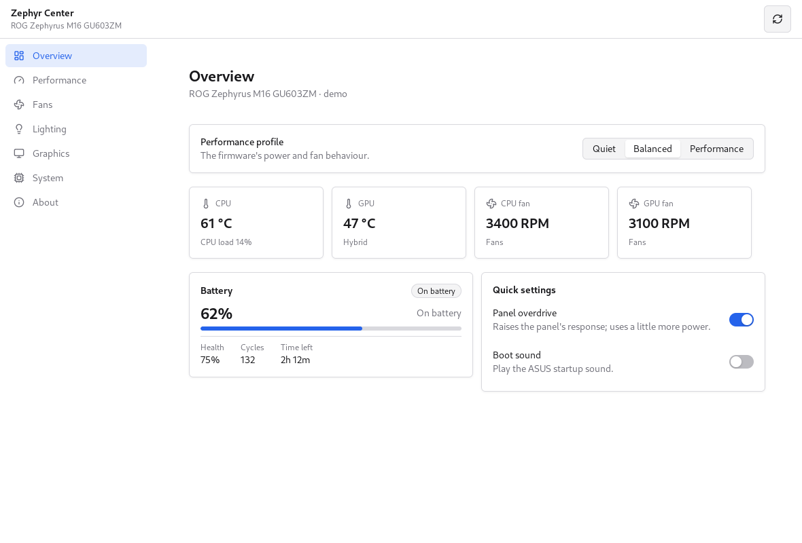
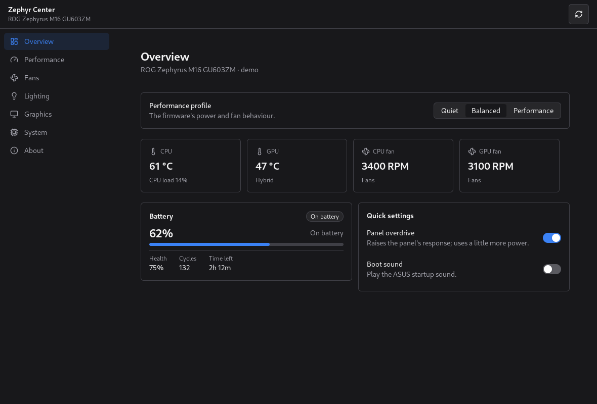

# Zephyr Center

<p align="center"><a href="README.md">English</a> | 简体中文</p>

[](https://awesomemygo.dev/apps/zephyr-center)

Zephyr Center 是一个用 [MyGo](https://github.com/egoist/mygo) 和
[CrychicUI](https://github.com/ELY-Open-Source/CrychicUI) 构建的轻量级跨平台华硕游戏本控制中心。Linux 和 Windows 共用同一套界面、控件和客户端窗口装饰（CSD），Linux 端对接 [asusd](https://gitlab.com/asus-linux/asusctl)，Windows 端对接 [G-Helper](https://github.com/seerge/g-helper) 的 ACPI 层。

目前是 MVP 版本，两个平台都提供性能模式、电池养护、风扇曲线、键盘灯效、显卡模式和整机信息，界面支持英文和简体中文。



深色主题下的同一界面：



## 已实现功能

- **概览**：当前性能模式，电池电量、健康度和功耗，充电上限，CPU 和 GPU
  温度与风扇转速，以及固件开关（面板超频、开机音效）。
- **性能**：平台模式、各模式绑定的 PPD 预设，以及 asusd 提供的功耗限制
  （PL1、PL2、NVIDIA 动态加速和温度目标）。
- **风扇**：各性能模式下的 CPU 和 GPU 风扇曲线，可拖动八个控制点或用方向键
  编辑，也可启用、停用或恢复固件的默认设置。
- **灯效**：针对 asusd 找到的 Aura 设备，可调节亮度、灯效、区域、速度、
  方向、两种颜色和电源状态。Windows 下通过 ASUS HID 或 ACPI 控制同一组设置。
- **显卡**：集成、混合和 Ultimate 三种模式；两个平台都只有经过 Ultimate 的切换需要重启。
- **系统**：型号、主板、BIOS、CPU、两块 GPU、内核和操作系统，以及 asusd
  读取的固件属性。Windows 从 WMI 填充相同字段，并补齐电池功耗、健康度、循环次数和剩余时间。
- **关于**：版本信息、语言选择和许可证。
- **托盘**：关闭窗口后应用继续在通知区域运行，可从托盘**打开 Zephyr 中心**
  或**退出 Zephyr 中心**。Linux 和 Windows 使用同一个图标。

窗口每两秒根据一次快照重绘，读数能保持实时，同时不会阻塞 UI 线程。所有写入都交给
后端，不直接写 sysfs，因此在 Linux 上 asusd 仍是唯一的写入方。

## 运行

仓库地址为 `Ne0W0r1d/zephyr-center`，克隆到 `zephyr-center` 目录：

```sh
git clone https://github.com/Ne0W0r1d/zephyr-center
cd zephyr-center
```

Linux 端需要先运行 `asusd`：

```sh
go run ./cmd/zephyr-center
```

没有 ASUS 硬件时，可以运行演示后端查看界面：

```sh
go run ./cmd/zephyr-center -demo
```

截图也由演示后端生成：

```sh
ZEPHYR_SCREENSHOTS=docs/screenshots go test ./internal/app -run TestScreenshots
```

该命令会生成所有页面的浅色和深色截图。仓库中的 `docs/screenshots`
已收录其中一部分。

## 托盘

Linux 端使用 AppIndicator，需要安装 `libayatana-appindicator3` 运行库
（Debian/Ubuntu 包名为 `libayatana-appindicator3-1`，Arch 为
`libayatana-appindicator`）；旧版 `libappindicator3` 也可用。GNOME 还需要启用
显示状态图标的扩展，例如 **AppIndicator and KStatusNotifierItem Support**；
KDE Plasma、Xfce、Cinnamon 等桌面可直接显示。

如果无法加载 `libayatana-appindicator3`，应用会记录托盘创建失败，并
保留关闭按钮的正常行为，而不是把窗口藏起来后无法找回。

## Windows

Windows 版本会启动 `zephyr-center-helper.exe`。这是一个小型控制台程序，
链接 G-Helper 的 `AsusACPI` ACPI 层，通过 stdin/stdout 收发 JSON。
两个程序一起构建：

```sh
./scripts/build-windows.sh
```

脚本使用 `dotnet` 发布 `windows/bridge`，并交叉编译 Go 应用，两个产物都放进
`dist/windows/`。在这个目录中运行 `zephyr-center.exe`。和 G-Helper 一样，
它需要 ASUS ATKACPI 驱动。

两个程序都以 GUI 方式构建（`-H windowsgui` 与 `WinExe`），helper 还以
`CREATE_NO_WINDOW` 启动，因此窗口旁边不会再弹出控制台。应用日志改写进
`%APPDATA%/zephyr-center/zephyr-center.log`，因为 GUI 程序没有 stderr 可写。

桥接层覆盖性能模式、充电上限、各模式风扇曲线及其“使用自定义曲线”开关和恢复默认、
功耗限制、显卡模式（含 MUX 直连切换）、键盘灯效，以及系统和电池详情。Windows
下由 helper 记住各模式的曲线，并在模式切换时重新应用已启用的曲线。PPD 预设绑定
仍仅限 Linux，因为 power-profiles-daemon 在 Windows 上没有对应实现。

Windows 下固件的 Turbo 模式显示为**增强**，以免和同一页面上的 Windows 电源模式
滑块混淆。固件无法回读当前模式与充电上限（模式端点返回的是本机支持的模式掩码），
因此 helper 把两者记在 `%APPDATA%/zephyr-center/bridge.json`，并在启动时重新应用。

显卡模式取决于 MUX：当它把屏幕直连到独显（Ultimate）时，驱动会拒绝写入 eco 端点，
所以离开 Ultimate 只切换 MUX，并在下次重启后生效。排队的模式同样记在上面那个文件里，
因此重启应用后仍然保留，也可以通过重新选择 Ultimate 撤销。

两个平台都使用客户端窗口装饰：应用自己绘制最小化、最大化和关闭按钮，并隐藏系统
自带的窗口按钮，因此 Windows 的标题栏按钮不会再遮住内容。

## 图标

应用图标和托盘图标都来自
`data/io.github.ne0w0r1d.ZephyrCenter.svg`。生成的资源包括：

- `data/icons/hicolor`：Linux 图标主题，覆盖 16x16 到 512x512，并包含可缩放 SVG；
- `data/windows/zephyr-center.ico`：包含常用尺寸的 Windows 图标；
- `cmd/zephyr-center/rsrc_windows_amd64.syso`：编进 Windows 可执行文件的同一图标；
- `internal/appicon`：嵌入 Go 程序的窗口与托盘 PNG。

修改 SVG 后，使用 ImageMagick、Pillow 和 `go-winres` 重新生成：

```sh
./scripts/build-icons.sh
```

## 构建

每次 push 和 pull request 时，GitHub Actions 都会运行测试和两个平台的构建
（`.github/workflows/ci.yml`）。

`.github/workflows/release.yml` 会发布两类版本：

- 每次向 `main` push 时，都会用该提交的快照替换唯一的 **rolling** 预发布版本，
  标签为 `rolling`；
- 推送 `v1.0.0` 之类的版本标签时，会发布稳定版，附带带版本号的
  `linux-amd64` 和 `windows-amd64` 压缩包。

两个发布通道包含相同的文件和 `SHA256SUMS`。版本标签会写入“关于”页面。
要在本地生成压缩包，请运行 `./scripts/build-linux.sh` 或
`./scripts/build-windows.sh`，并设置 `VERSION=1.2.3`。

## 语言

应用会跟随桌面语言，找不到对应语言时回退到英文。用户可以在“关于”页面另行选择，
MyGo 会记住选择。

语言目录是 `internal/i18n/catalogs` 下 ARB 风格的 JSON：`en.json` 是源文件，
`zh-Hans.json` 是中文翻译。翻译中缺少某个键时会回退到英文；当一个目录与另一个
目录不一致时，`TestCatalogsHaveTheSameKeys` 会失败。要添加语言，请把 `en.json`
复制为 `<tag>.json`，翻译其中的值，然后运行 `go test ./internal/i18n`。

## 许可证

应用采用 **MPL-2.0 OR GPL-3.0-or-later** 双许可证（见 `LICENSE`）。
MPL 让 Linux 版本的许可条款与 asusctl 接近；提供 GPL 选项，是为了让 Windows
桥接层能链接采用 GPL-3.0-or-later 的 G-Helper，而无需为整个应用重新授权。

- `licenses/MPL-2.0.txt` 和 `licenses/GPL-3.0.txt` 是完整的许可证文本。
- `windows/bridge` 仅采用 GPL-3.0-or-later，因为它源自 G-Helper。
- CrychicUI 采用 MIT 许可证；MyGo 采用 MIT 许可证。`NOTICE` 列出了上游项目。

每个源文件都带有 `SPDX-License-Identifier` 行。

## 目录结构

```
cmd/zephyr-center         the app
internal/app              the window, pages, CrychicUI helpers and the curve editor
internal/backend          the contract both machines implement
internal/backend/asusd    Linux: asusd over D-Bus, sysfs for sensors
internal/backend/ghelper  Windows: the JSON bridge
internal/backend/fake     a made-up machine, for tests and screenshots
internal/i18n             catalogs and lookup
windows/bridge            the GPL-3.0 Windows helper, built on G-Helper
```

## MVP 暂未包含

Anime Matrix、Slash 灯效、ROG Ally 和 XG Mobile、单键 Aura、通知、全局快捷键
和开机自启。上游项目具备这些功能；这次重写先从用户日常会调整的设置做起。
